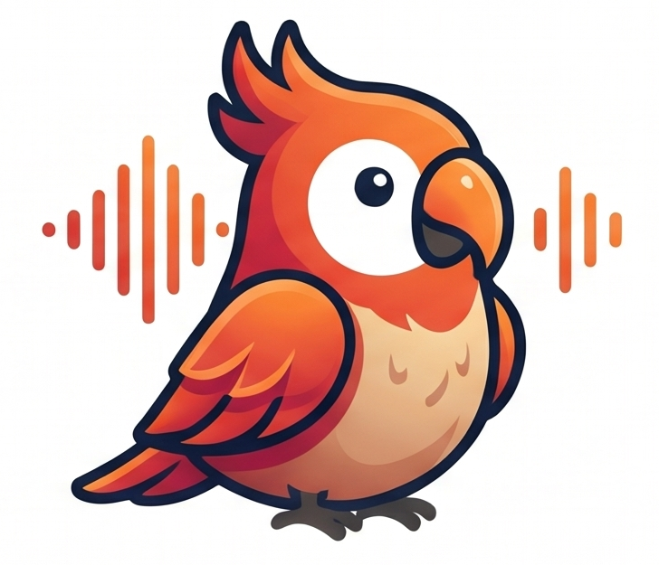

<p align="center">
  
</p>

<h1 align="center">VoicePrompt</h1>

<p align="center">단축키를 누르고 말하면, 말한 내용을 그대로 프롬프트 입력창에 적어 주는 macOS 앱</p>

## 무엇을 하나요

- **단축키 한 번으로 받아쓰기**: `⌃⌥Space`를 누르고 말한 뒤 다시 누르면, 커서가 있던 입력창에 문장이 들어갑니다.
  Claude Code, ChatGPT, 브라우저 등 어디서나 쓸 수 있습니다.
- **실시간 미리보기**: 말하는 동안 작은 카드에 인식 중인 글자가 바로 표시됩니다.
- **완전 로컬·무료**: 음성 인식이 Mac 안에서만 돌아갑니다. 음성이 외부로 나가지 않고,
  API 키나 구독이 필요 없습니다.
- 입력만 하고 Enter는 누르지 않으므로, 내용을 확인한 뒤 직접 전송하면 됩니다.

## 어떻게 만들었나요

| 구성 | 사용한 것 | 만든 곳 |
|---|---|---|
| 음성 인식 모델 | **Whisper large-v3 turbo** (`large-v3-v20240930_turbo`, MIT 라이선스) | [OpenAI](https://github.com/openai/whisper) |
| 추론 엔진 | [WhisperKit](https://github.com/argmaxinc/WhisperKit) 1.1.1: Whisper를 Core ML로 Apple Silicon에서 실행 (MIT 라이선스) | [Argmax](https://www.argmaxinc.com) |
| 앱 | Swift + SwiftUI/AppKit 메뉴 막대 앱 (Swift Package Manager, Xcode 없이 명령줄 도구로 빌드) | 직접 개발 |
| 단축키 | Carbon 전역 단축키 | Apple (macOS 기본 API) |
| 자동 입력 | 손쉬운 사용(Accessibility)으로 포커스 확인 후 `⌘V` 붙여넣기, 기존 클립보드 복원 | Apple (macOS 기본 API) |

- **실시간 처리**: 새 음성이 0.3초 쌓일 때마다 다시 인식해, 약 0.5초 간격으로 미리보기를 갱신합니다.
  확정된 앞부분은 고정하고 뒷부분만 바꿉니다.
- **잘못된 문구 차단**: Whisper가 무음에서 "감사합니다." 같은 문구를 지어내는 현상을
  음성 크기 검사와 상투 문구 필터로 막습니다.

## 시작하기

Apple Silicon Mac, macOS 14 이상이 필요합니다.

```sh
./scripts/setup-signing.sh   # 처음 한 번: 빌드 후에도 자동 입력 권한이 유지되도록 로컬 서명 준비
./scripts/build.sh
open dist/VoicePrompt.app
```

1. 설정에서 **음성 인식 모델**(약 1.5 GB 다운로드), **마이크**, **자동 입력** 권한을 준비합니다.
2. 입력창을 클릭하고 `⌃⌥Space`를 누른 뒤 말합니다.
3. 다시 `⌃⌥Space`를 누르면 문장이 입력됩니다. `Esc`는 취소입니다.

단축키는 설정에서 바꿀 수 있습니다. 검증은 `./scripts/check.sh`로 실행합니다.

라이선스 고지는 [THIRD_PARTY_NOTICES.md](THIRD_PARTY_NOTICES.md)에 있습니다.
